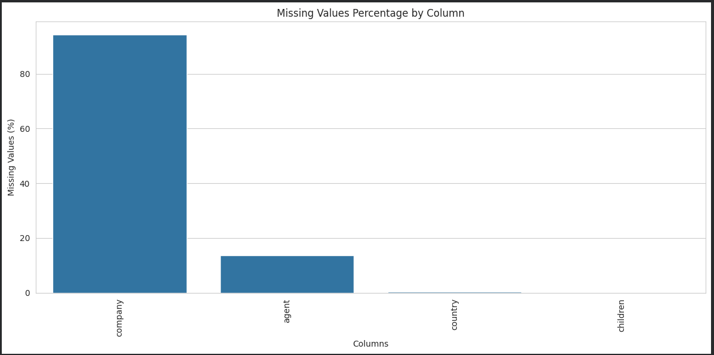
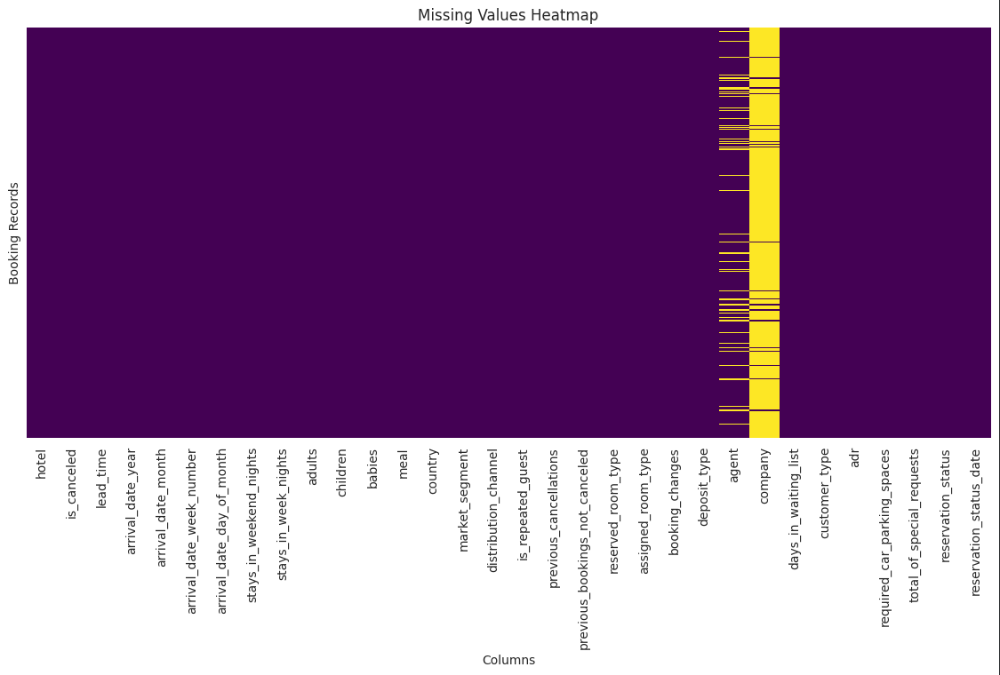
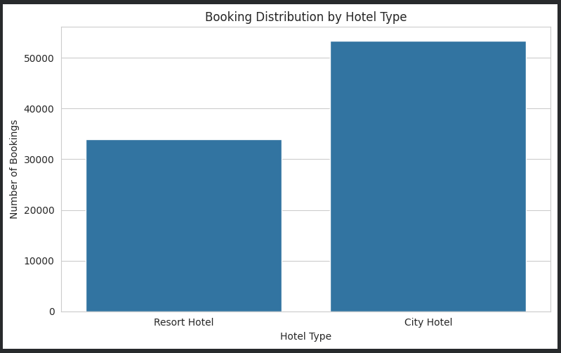
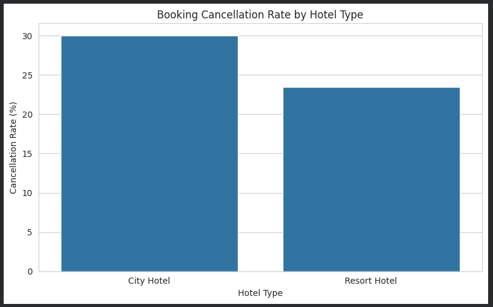
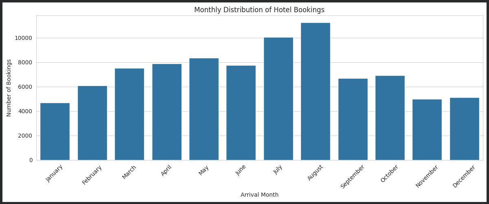
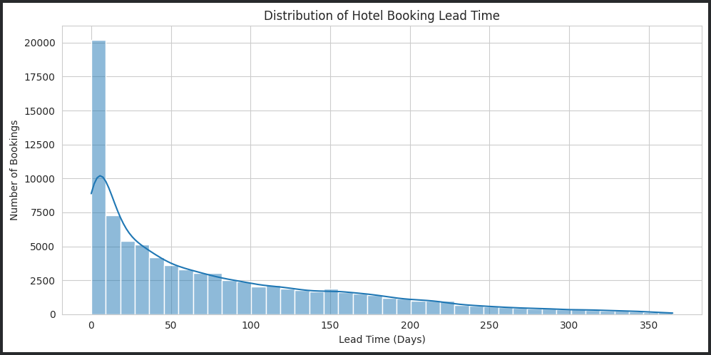
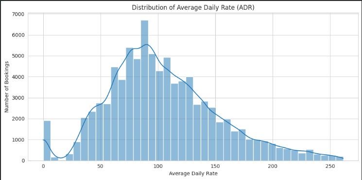
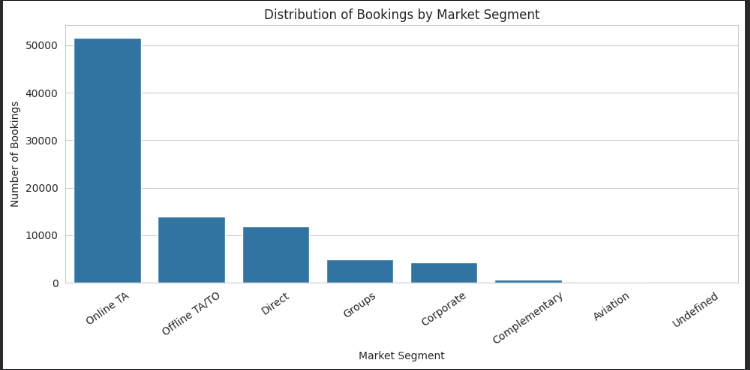
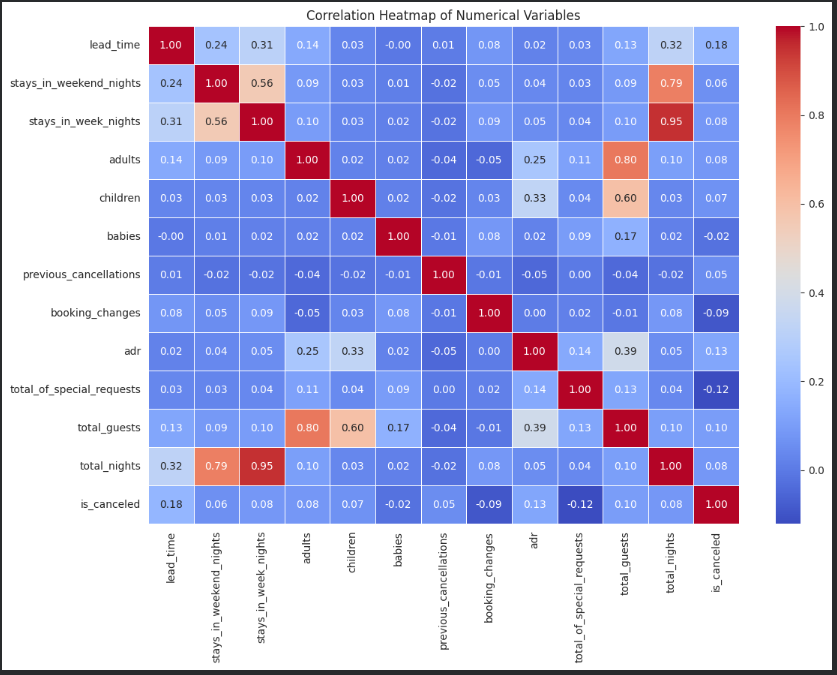

# Hotel Booking Demand - Exploratory Data Analysis

## 📋 Project Details

This project focuses on exploring the Hotel Booking Demand dataset using Python and Pandas. The main aim is to understand hotel booking patterns, customer preferences, cancellation behaviour, and other factors related to hotel reservations.

I used Python, Pandas, Matplotlib and Seaborn to inspect the data, deal with missing values and duplicate records, calculate summary statistics, and create visualisations. I wanted to go beyond simply looking at the numbers and find patterns that help explain how people book hotels, when they travel, and how often bookings are cancelled.

The analysis was carried out in Google Colab.

---
## 📊 Dataset

Dataset: Hotel Booking Demand

Source: [Hotel Booking Demand – Kaggle](https://www.kaggle.com/datasets/jessemostipak/hotel-booking-demand)

The dataset contains hotel booking information from two types of hotels:
- City Hotel

- Resort Hotel

### Dataset Details:
- Original number of records: 119,390

- Number of columns: 32

- Numerical and categorical features are included.

### Some of the important columns are:
- hotel – Type of hotel.

- is_canceled – Whether the booking was cancelled.

- lead_time – Number of days between booking and arrival.

- arrival_date_month – Month of arrival.

- adults, children, babies – Number of guests.

- country – Country of the guest.

- market_segment – Booking market segment.

- adr – Average Daily Rate.
---
## ⚙️ Data Preprocessing

Before starting the analysis, I first checked the dataset to understand its structure and identify issues that needed to be addressed.

The following preprocessing steps were performed:

1. **Checking the Dataset:** Loaded the dataset and examined its shape, column data types, memory usage, and first and last few rows.

2. **Checking Missing Values:** Identified missing values in each column and used a visualization to understand their distribution.

3. **Handling Duplicate Records:** Checked for duplicate records and removed 31,994 exact duplicates to avoid repeated entries in the analysis.

4. **Handling Missing Values:**
   - Filled missing values in the 'children' column using the median.
   - Replaced missing values in the 'country' column with 'unknown'.
   - Retained missing values in the 'agent' and 'company' columns because there was no reliable way to determine their actual values.

5. **Data Type Conversion:** Converted `reservation_status_date' into datetime format to support date-related analysis.

6. **Feature Creation:** Created two additional columns to make the analysis easier:
   - `total_guests' – Total number of adults, children, and babies.
   - `total_nights' – Total number of weekend and week nights.

7. **Outlier Analysis:** Investigated unusual values in columns such as ADR, lead time, and number of guests. This included negative or unusually high ADR values, bookings with no guests, and very long lead times.

After removing exact duplicate records, the cleaned dataset contained **87,396 rows and 32 columns**. Extreme values were excluded only from specific visualizations where necessary to make the main patterns easier to understand. These records were not removed from the main cleaned dataset.

### Missing Value Analysis
---
I used two visualizations to understand the distribution of missing values in the dataset.

**1. Missing Values Percentage by Column**

This chart shows the percentage of missing values in each column. The 'company' column had the highest percentage of missing values (94.31%), followed by 'agent' (13.69%). The 'country' and 'children' columns had very few missing values.

**2. Missing Values Heatmap**

The heatmap provides a visual overview of missing values across the booking records. It shows that missing values are mainly concentrated in the 'company' and 'agent' columns, while most other columns contain complete records.

---

## 🔍 Exploratory Data Analysis

After preprocessing, I explored the dataset to understand hotel booking patterns, customer preferences, and relationships between different variables.

### The analysis covered the following areas:
- **Numerical Analysis:** Used summary statistics such as mean, median, standard deviation, minimum, and maximum values to understand numerical columns.
- **Categorical Analysis:** Used value counts to examine categories such as hotel type, meal preference, market segment, distribution channel, and customer type.
- **Hotel Booking Patterns:** Explored the distribution of bookings between City Hotels and Resort Hotels.
- **Cancellation Analysis:** Compared cancellation rates between the two hotel types to understand differences in booking cancellations.
- **Monthly Booking Trends:** Examined the number of bookings across different arrival months to identify seasonal patterns.
- **Booking Lead Time:** Studied how far in advance customers usually made their reservations.
- **Length of Stay:** Explored the number of weekend and week nights spent by guests.
- **Average Daily Rate (ADR):** Examined the distribution of hotel room rates and identified common price ranges.
- **Market Segment Analysis:** Investigated the different market segments contributing to hotel bookings.
- **Correlation Analysis:** Used a correlation heatmap to understand relationships between numerical variables and identify patterns among them.

## Visualisations
I created seven visualisations, each to explore a different question about the bookings:

### 1. Hotel Type Distribution

### 2. Cancellation Rate by Hotel Type

### 3. Monthly Booking Trends

### 4. Booking Lead Time Distribution

### 5. Average Daily Rate (ADR) Distribution

### 6. Market Segment Distribution

### 7. Correlation Heatmap

---

## 📌 Key Observations

While exploring the dataset, I came across a few interesting patterns:

- **City Hotels received more bookings** compared to Resort Hotels.
- **July and August had the highest number of arrivals**, showing that these months were particularly busy.
- **Cancellations were more common for City Hotels** than for Resort Hotels.
- **Online Travel Agents contributed the largest share of bookings**, making them the most commonly used market segment.
- **Booking lead times varied quite a bit.** Most guests made their bookings closer to their arrival date, while some booked several months in advance.

These patterns helped me get a better understanding of booking behaviour in the dataset. They reflect only the data explored in this project and may differ across other hotels or destinations.

---
## 🛠️ Technologies Used

- Python
- Pandas
- NumPy
- Matplotlib
- Seaborn
- Google Colab
---
## 📝 Conclusion

Through this project, I explored the Hotel Booking Demand dataset using Python and Pandas. I worked on cleaning the data, handling missing values and duplicates, identifying outliers, and creating visualizations to understand booking patterns.

The analysis helped me identify trends in hotel bookings, cancellation rates, customer preferences, and booking lead times. It also gave me practical experience in working with a real-world dataset and presenting findings through visualizations.

Overall, this project helped me improve my understanding of Exploratory Data Analysis and how data can be used to identify meaningful patterns and insights.
